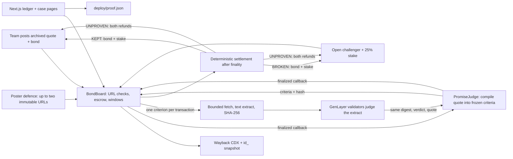

# Roadmap Bond

Roadmap promises with a price tag: validators decide if it shipped or just got renamed.

Roadmap Bond turns one sentence from a team's archived roadmap into a bonded commitment. The promise is quoted from an exact Wayback snapshot; validators compile observable criteria; an open challenger can stake against it after the deadline; deterministic contract code routes the bond only after finalized judgments.

**Current release state:** the local contracts and app are implemented, but no Roadmap Bond contract or case is recorded as deployed. The proof manifest is intentionally empty until a live StudioNet release finalizes. Mocked direct tests are not live proof.

The release is blocked by external access in this environment. The StudioNet RPC hostname does not resolve, GitHub writes are denied by the connected integration while the saved CLI token is invalid, and the available Vercel team denied project creation. See [`docs/decisions.md`](docs/decisions.md) for the exact results. No funding, deployment, public repository creation, fixture commit, Portal submission, or live case is claimed.

## Architecture



`BondBoard` owns escrow, deadlines, state transitions, refunds, release, and payout recipients. `PromiseJudge` holds no funds; it compiles the quote and judges a single criterion against a digest-bound evidence extract. The model returns a verdict and short evidence quote. It cannot choose amounts, winners, or transaction order.

## Settlement paths

| Final state | Contract result |
|---|---|
| Every criterion is `MET` | Poster receives the bond and the challenger's stake. |
| Any criterion is `NOT_MET` | Challenger receives the bond and their stake. |
| No failure, at least one `INSUFFICIENT_EVIDENCE` | Both parties receive their original amounts. |
| No challenge by the end of the challenge window | Poster receives the bond. |
| Compilation or judging exceeds its grace window | Contract provides a refund path; unresolved evidence does not strand funds. |
| Quote cannot become an observable specification | Promise is `REJECTED`; poster can reclaim the bond. |

## Local setup

Requirements: Python with the versions in `requirements.txt`, Node.js compatible with the pinned Next.js package, and the GenLayer CLI for live StudioNet operations.

```powershell
python -m pip install -r requirements.txt
npm ci
python scripts/generate_keys.py
npm run dev
```

The generated demo signers are kept only in `.env`, which is ignored by Git. The key-generation command refuses to overwrite an existing file. Do not print, commit, or send those keys.

Read-only visitors do not need a wallet. Wallet writes use an EIP-1193 provider, switch to StudioNet (chain 61999), and ask the provider to sign. Contract calls and scripted release operations are covered in `docs/tutorial.md`.

## Validate and release

```powershell
npm run test:contract
npm run lint:contracts
python scripts/build_fixture.py
python scripts/probe.py
python scripts/fund_accounts.py
npm run release
npm run audit:links
npm run verify:proof
```

The required validator access probe runs before the two final contracts. Verify every historical snapshot and evidence URL through CDX, then mark `deploy/cases.json` ready with the pinned fixture commit and exact quotes. A deployment is not complete until probe results, final source hashes, every transaction and callback, each live case, the direct Explorer address pages, and the read-only proof verifier are recorded. The Portal form remains a human action; `docs/portal.md` is a prepared packet only.

## App behavior

- `/` is the promise ledger. It shows live StudioNet state when available and labels the recorded proof fallback separately.
- `/promise/<id>` shows the archived quote, frozen criteria and hash, windows, challenge and defence evidence, per-criterion quote/digest/reason, payout movements, and transaction states.
- `/api/proof` returns the release manifest.
- `/api/live` reads the latest finalized Board records, caches good reads for 60 seconds, and returns the last good or recorded proof state when RPC reads fail.
- Explorer links use `/address/<address>` and `/tx/<hash>` on the StudioNet Explorer.

## Honest limitations

- Wayback capture availability is external. Both the exact CDX row and archived page need to load when a promise is posted.
- Only Wayback `id_`, SHA-pinned `raw.githubusercontent.com`, exact npm versions, and Wikipedia `oldid` URLs are eligible evidence. The pre-deployment probe is required; unsupported sources must be removed from the final evidence allowlist.
- Text excerpts are limited to about 30 KB across sources. Oversized, unavailable, or irrelevant evidence becomes `INSUFFICIENT_EVIDENCE`; it does not establish fault.
- The model and validators are not a legal court. The contract stores their result, and GenLayer's native appeal window still applies before finality.
- `post_replay` is owner-only and exists for clearly labeled historical demonstrations. Production `post` still enforces a deadline at least 60 minutes ahead.
- Anyone may post a production promise. The archived quote must be the poster's public statement; the current contract cannot prove that the poster legally represents a project.
- No live case outcomes are included until finalized on StudioNet and accepted by `scripts/verify_proof.py`.

## Release history

- **Local implementation:** `BondBoard` and `PromiseJudge` are the only final contract sources. `AccessProbe` is a pre-release probe source, not a final contract and not Portal evidence.
- **StudioNet release:** none recorded yet. `deploy/proof.json` is empty by design; no address or transaction should be treated as deployed evidence.
- **Historical replay cases:** none finalized yet. When available, the app and the proof manifest label their replay status explicitly.
- **External access:** no repository or Vercel project was created. The connected GitHub write API returned 403 and `gh` has an invalid token; Vercel project creation returned 403 and its scoped CLI fallback could not reach npm/API metadata. StudioNet RPC DNS resolution also failed before any transaction was submitted.

## Documentation

- [`docs/tutorial.md`](docs/tutorial.md) — contract and frontend walkthrough.
- [`docs/demo-script.md`](docs/demo-script.md) — two-minute reviewer tour.
- [`docs/probe.md`](docs/probe.md) — probe status and evidence-access limitation.
- [`docs/portal.md`](docs/portal.md) — unsubmitted contribution packet.
- [`docs/decisions.md`](docs/decisions.md) — implementation and release decisions.
